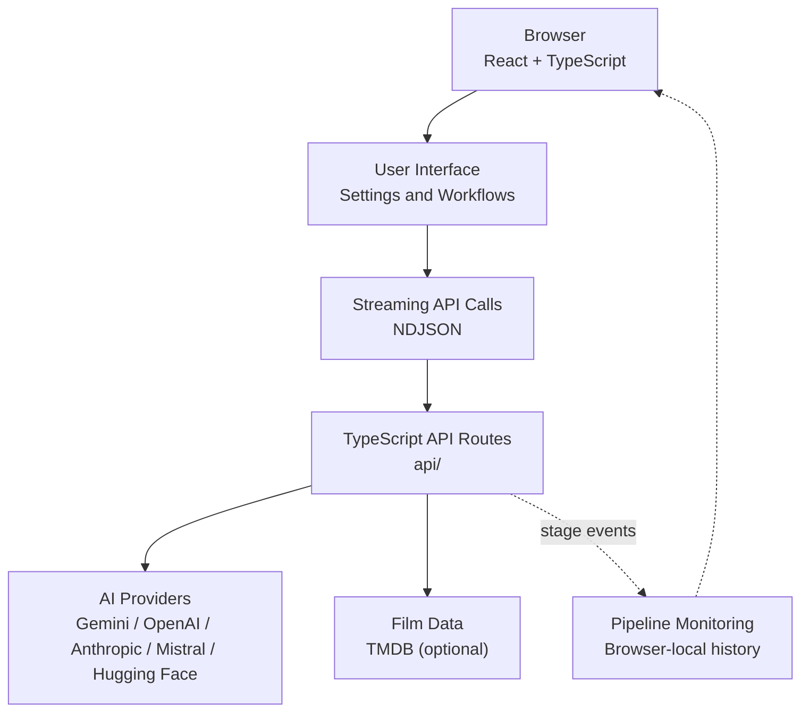
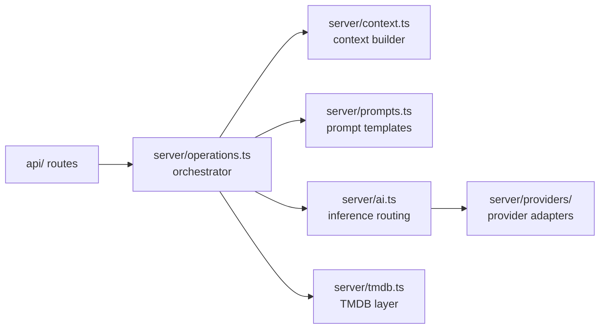

# 🎬 CineCritic

[](https://vercel.com)
[](https://www.typescriptlang.org)
[](https://react.dev)
[](https://vite.dev)
[](https://nodejs.org)

An **AI-powered film analysis and cinema intelligence platform** built with React, TypeScript, and Vite. CineCritic brings AI-assisted movie critique, film discovery, conversational questions, movie battles, and multi-provider AI configuration into a single interface.

Instead of hiding behind a generic loading spinner, CineCritic features a **live execution pipeline monitor** that surfaces real-time backend updates, metrics, and workflow progress to the user.

---

## 📑 Table of Contents

- [Architecture Diagram](#-architecture-diagram)
- [Features](#-features)
- [Tech Stack](#-tech-stack)
- [System Architecture](#-system-architecture)
- [Project Structure](#-project-structure)
- [Getting Started](#-getting-started)
- [Environment Configuration](#-environment-configuration)
- [Security & API Key Management](#-security--api-key-management)
- [Pipeline Streaming Schema](#-pipeline-streaming-schema)
- [Testing](#-testing)
- [Deployment](#-deployment)

---

## 🗺️ Architecture Diagram

Explore the full interactive architecture of this repository on GitDiagram:

👉 **[Open CineCritic on GitDiagram](https://gitdiagram.com/Kartik-pro/CineCritic)**

> 💡 Swap `github.com` for `gitdiagram.com` in the repo URL to open the same view for any GitHub repository.

---

## ✨ Features

### 🎥 AI-Powered Film Workflows

| Workflow | What it does |
| :--- | :--- |
| **Critique** | Runs deep, AI-assisted film critiques. |
| **Discover** | Explores new movies through tailored discovery flows. |
| **Ask** | Chat with your configured AI provider about specific films. |
| **Battle** | Compares two films side by side using analytical metrics. |
| **Connection Test** | Validates your API credentials before you run a workflow. |

### 🤖 Multi-Provider AI Support

Configure your own keys directly in the browser. Supported providers:

- Google Gemini
- OpenAI
- Anthropic
- Mistral
- Hugging Face Inference Providers

### ⚡ Live Pipeline Monitoring

- **Transparent execution:** real-time visibility into active stages (e.g. "2 of 6 films verified").
- **Status and metrics:** countdowns, elapsed time, retries, and errors.
- **Browser-local run monitor:** keeps the last 40 executions in your browser with precise metrics, without storing prompt details or keys.

---

## 🧰 Tech Stack

| Technology | Purpose |
| :--- | :--- |
| **React 19** | UI components and reactive rendering |
| **TypeScript** | Strict type safety across client code and API contracts |
| **Vite 7** | Fast dev server and optimized frontend builds |
| **Node.js 20+** | Runtime for tooling and serverless functions |
| **Vercel Functions** | Serverless API endpoints that handle streaming |
| **AI Providers** | Integrations with Gemini, OpenAI, Anthropic, and Mistral |
| **Hugging Face** | Unified Inference Providers router (`https://router.huggingface.co/v1`) |
| **TMDB API** | Optional metadata source for live film lookup and validation |
| **tsx** | Direct execution of the test suites |
| **Vercel Speed Insights** | Production performance and Core Web Vitals tracking |

---

## 🏗️ System Architecture

### High-Level Request Flow



### Server Layer



---

## 📁 Project Structure

```text
CineCritic/
├── api/                  # TypeScript serverless API endpoints (Vercel)
├── public/               # Static assets
├── server/               # Shared backend utilities
│   ├── providers/        # AI provider adapters and wrappers
│   ├── ai.ts             # Primary inference routing
│   ├── context.ts        # Context construction for models
│   ├── operations.ts     # Execution sequence orchestrator
│   ├── prompts.ts        # Prompt configurations and templates
│   └── tmdb.ts           # TMDB interface layer
├── shared/               # Types and protocols shared by client and server
│   ├── pipeline.ts       # Typed pipeline interfaces and NDJSON structures
│   ├── providers.ts      # Multi-provider schema profiles
│   └── scoring.ts        # Film comparison scoring parameters
├── src/                  # React SPA (Vite)
│   ├── components/       # Reusable UI components
│   ├── pages/            # Views (Critique, Discover, Battle, Monitor, Settings, ...)
│   ├── pipeline/         # Client-side stream parsers and runners
│   ├── keys.ts           # Browser credential management
│   └── state.tsx         # Global context providers
├── tests/                # Unit and integration tests
├── vercel.json           # Vercel deployment and function config
├── tsconfig.json         # Strict TypeScript config
└── package.json          # Dependencies and scripts
```

---

## 🚀 Getting Started

### Prerequisites

- **Node.js** 20.x or later
- **npm** (bundled with Node)
- **Vercel CLI**, installed globally to run the serverless functions locally:

```bash
npm i -g vercel
```

### 1. Clone the repository

```bash
git clone https://github.com/Kartik-pro/CineCritic.git
cd CineCritic
```

### 2. Install dependencies

```bash
npm install
```

### 3. Start the local dev environment

Run the React frontend and the Vercel serverless functions together:

```bash
npx vercel dev
```

The app boots at **http://localhost:3000**.

> ⚠️ **Note:** `npm run dev` starts only the Vite frontend and **does not** serve the endpoints in `/api`. Use `npx vercel dev` to test live AI workflows.

---

## 🔑 Environment Configuration

A `.env` file is **entirely optional**. Users can enter their keys in the app's UI. Add server-side keys only if you want your deployment to supply fallback credentials.

Create a `.env` file in the project root:

```dotenv
# Film data provider
TMDB_API_KEY=your_tmdb_v3_or_v4_token

# AI provider keys
ANTHROPIC_API_KEY=your_anthropic_api_key
OPENAI_API_KEY=your_openai_api_key
GOOGLE_API_KEY=your_google_gemini_api_key
MISTRAL_API_KEY=your_mistral_api_key
HF_TOKEN=your_fine_grained_huggingface_token

# Server fallback defaults
AI_PROVIDER=gemini
AI_MODEL=your_preferred_model_id
```

### Variable Reference

| Variable | Required | Purpose |
| :--- | :--- | :--- |
| `TMDB_API_KEY` | Optional | Resolves exact film metadata, posters, and filtering data. |
| `ANTHROPIC_API_KEY` | Optional | Credential for Anthropic-backed models. |
| `OPENAI_API_KEY` | Optional | Credential for OpenAI-backed models. |
| `GOOGLE_API_KEY` | Optional | Credential for Google Gemini models. |
| `MISTRAL_API_KEY` | Optional | Credential for Mistral models. |
| `HF_TOKEN` | Optional | Needs the **Make calls to Inference Providers** permission. |
| `AI_PROVIDER` | Optional | Fallback engine: `anthropic`, `openai`, `gemini`, `mistral`, or `huggingface`. |
| `AI_MODEL` | Optional | Fallback model ID. Required when using Hugging Face as the server fallback. |

---

## 🔐 Security & API Key Management

- **Storage location:** keys stay on your device. By default they live in `sessionStorage` and disappear when the tab closes.
- **Persistent storage:** ticking **"Remember keys on this device"** moves them to `localStorage`.
- **Encryption notice:** browser storage is not encrypted. Use restricted, spend-capped API keys.
- **Transmission:** keys are sent over HTTPS to your own API routes, held in memory for the duration of the request, and never logged or persisted by the server.

---

## ⚡ Pipeline Streaming Schema

Workflows stream progress as **Newline-Delimited JSON (NDJSON)**: one JSON object per line, each describing a stage update.

```json
{"executionId":"example-run-id","operation":"critique","stage":"verifying","message":"2 of 6 films verified","progress":{"current":2,"total":6},"elapsedMs":4210,"retries":0}
{"executionId":"example-run-id","operation":"critique","stage":"complete","message":"Critique ready","elapsedMs":9870,"retries":0}
```

### Reading the stream on the client

```ts
const response = await fetch("/api/critique", { method: "POST", body });
const reader = response.body!.getReader();
const decoder = new TextDecoder();
let buffer = "";

while (true) {
  const { value, done } = await reader.read();
  if (done) break;
  buffer += decoder.decode(value, { stream: true });

  const lines = buffer.split("\n");
  buffer = lines.pop() ?? "";

  for (const line of lines) {
    if (line.trim()) handleEvent(JSON.parse(line));
  }
}
```

> 📝 The field names above are illustrative. The authoritative event types live in [`shared/pipeline.ts`](shared/pipeline.ts).

---

## 🧪 Testing

Tests run directly with `tsx`. Check the `scripts` section of `package.json` for the exact commands, for example:

```bash
npm test
```

---

## 🌐 Deployment

CineCritic deploys to Vercel with zero extra configuration beyond `vercel.json`.

```bash
vercel          # preview deployment
vercel --prod   # production deployment
```

Add any optional server-side keys from [Environment Configuration](#-environment-configuration) in the Vercel project settings under **Environment Variables**.
